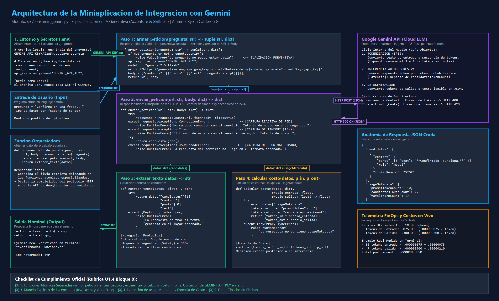

# Arquitectura de la Miniaplicación de Integración con IA

> **Módulo:** `src/consumir_gemini.py`  
> **Programa:** Especialización en Desarrollo con IA Generativa (Accenture & Skillnest)  
> **Participante:** Byron Calderón González (`by-matt`)  
> **Unidad:** U1.4 Fundamentos de IA Generativa y Arquitectura de Aplicaciones (Bloque 8)

---

## 1. Diagrama Oficial de Arquitectura

El siguiente diagrama detalla el flujo de datos, el aislamiento de secretos, las funciones atómicas bajo el Principio de Responsabilidad Única (SRP), los puntos de captura de excepciones y la telemetría de costos en vivo:



---

## 2. Los 5 Componentes de la Arquitectura

### 1. Descomposición Modular Atómica (SRP)
En lugar de un script monolítico, la lógica se distribuye en funciones atómicas que realizan una sola tarea:
* **`armar_peticion(pregunta: str) -> tuple[str, dict]`**: Valida la entrada, lee las credenciales del entorno y genera la tupla con la URL del endpoint y el cuerpo JSON (`contents`).
* **`enviar_peticion(url: str, body: dict) -> dict`**: Gestiona el transporte HTTP POST con timeout de 15 segundos y decodifica el stream a un diccionario Python.
* **`extraer_texto(datos: dict) -> str`**: Navega de forma defensiva la estructura de respuesta (`candidates[0].content.parts[0].text`).
* **`calcular_costo(datos: dict, precio_entrada: float, precio_salida: float) -> float`**: Extrae las métricas de `usageMetadata` y computa el costo financiero exacto del request.
* **`obtener_dato_de_prueba(pregunta: str) -> str`**: Función orquestadora que compone las funciones anteriores para proveer una API pública limpia al resto de la aplicación.

### 2. Aislamiento y Ciclo de Vida de Secretos (Zero Leaks)
* La clave `GEMINI_API_KEY` reside exclusivamente en el archivo local `.env`.
* `.env` está estrictamente ignorado por Git en el archivo `.gitignore`.
* En tiempo de ejecución, la librería `python-dotenv` carga las variables al entorno del proceso (`load_dotenv()`), y `armar_peticion` la obtiene dinámicamente mediante `os.getenv("GEMINI_API_KEY")`. Ningún secreto se expone en código ni en el historial de commits.

### 3. Matriz de Manejo de Excepciones y Resiliencia
El sistema no delega errores crudos ni colapsa con tracebacks al usuario final:

| Función | Tipo de Validación | Excepción Capturada | Acción / Error Controlado |
| :--- | :--- | :--- | :--- |
| `armar_peticion` | Preventiva (Control Interno) | `not pregunta.strip()` | Lanza `ValueError("La pregunta no puede estar vacia")` |
| `enviar_peticion` | Reactiva (Red Externa) | `requests.exceptions.ConnectionError` | Lanza `RuntimeError("No se pudo conectar con el servicio...")` |
| `enviar_peticion` | Reactiva (SLA / Red) | `requests.exceptions.Timeout` | Lanza `RuntimeError("El tiempo de espera se agoto...")` |
| `enviar_peticion` | Reactiva (Protocolo) | `requests.exceptions.JSONDecodeError` | Lanza `RuntimeError("La respuesta no llego en formato esperado...")` |
| `extraer_texto` | Reactiva (Estructura API) | `KeyError`, `IndexError` | Lanza `RuntimeError("La respuesta no trae el texto generado...")` |
| `calcular_costo` | Reactiva (Metadatos) | `KeyError`, `TypeError` | Lanza `RuntimeError("No contiene usageMetadata o conteo esperado")` |

### 4. Modelo de Inferencia y Cálculo de Costo en Vivo (FinOps)
Gemini 2.5 Flash devuelve un bloque `usageMetadata` que registra el consumo exacto de tokens:
```json
"usageMetadata": {
  "promptTokenCount": 10,
  "candidatesTokenCount": 7,
  "totalTokenCount": 17
}
```
* **Fórmula canónica:**
  $$\text{Costo Total (USD)} = (\text{promptTokenCount} \times P_{\text{entrada}}) + (\text{candidatesTokenCount} \times P_{\text{salida}})$$
* **Tarifas de referencia de Google Gemini 2.5 Flash:**
  * Entrada: $\$0.075$ USD por 1M tokens ($\$0.000000075$ / token).
  * Salida: $\$0.300$ USD por 1M tokens ($\$0.000000300$ / token).
* **Consumo medido en prueba real:**
  $$\text{Costo} = (10 \times 0.000000075) + (7 \times 0.000000300) = \$0.00000285\text{ USD}$$

### 5. Flujo de Datos Tipado entre Componentes
1. `Usuario` $\xrightarrow{\text{pregunta: str}}$ `armar_peticion`
2. `.env` $\xrightarrow{\text{GEMINI\_API\_KEY: str}}$ `armar_peticion`
3. `armar_peticion` $\xrightarrow{\text{tuple}[url:\text{ str}, body:\text{ dict}]}$ `enviar_peticion`
4. `enviar_peticion` $\xrightarrow{\text{HTTP POST (JSON)}}$ `Google Gemini API`
5. `Google Gemini API` $\xrightarrow{\text{HTTP 200 OK (Raw JSON stream)}}$ `enviar_peticion`
6. `enviar_peticion` $\xrightarrow{\text{datos: dict [candidates]}}$ `extraer_texto`
7. `extraer_texto` $\xrightarrow{\text{texto: str}}$ `Salida / Usuario`
8. `enviar_peticion` $\xrightarrow{\text{datos: dict [usageMetadata]}}$ `calcular_costo`
9. `calcular_costo` $\xrightarrow{\text{costo: float (USD)}}$ `Telemetría FinOps / Usuario`
